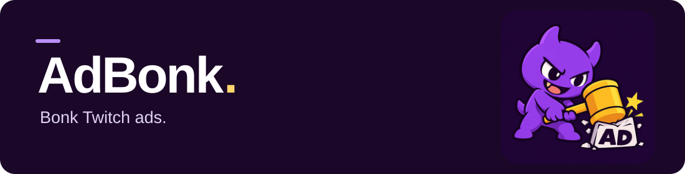

<p align="center">
  
</p>

<p align="center">
  <a href="https://raw.githubusercontent.com/rafelolv/AdBonk/main/vaft/vaft.user.js"><strong>Install AdBonk</strong></a>
  &nbsp; · &nbsp;
  <a href="#getting-started">Getting started</a>
  &nbsp; · &nbsp;
  <a href="https://github.com/rafelolv/AdBonk/issues">Report a problem</a>
  &nbsp; · &nbsp;
  <a href="LICENSE">MIT license</a>
</p>

AdBonk is a userscript that blocks ads on Twitch live streams. It continues [pixeltris's TwitchAdSolutions](https://github.com/pixeltris/TwitchAdSolutions), starting from the updated [ryanbr fork](https://github.com/ryanbr/TwitchAdSolutions).

**Thank you, pixeltris.** You started what I still consider the best Twitch ad blocker. The original project has been discontinued, but it continues to work well in my experience. AdBonk is my attempt to keep that work going.

I'm [rafelolv](https://github.com/rafelolv), a DevOps/SRE. Coding isn't the main focus of my work, but I'll do my best to maintain this project. Fixes, commits, and pull requests are always welcome.

## Getting started

You need a **userscript manager**: a browser extension that runs AdBonk on Twitch. You don't need to download this repository or run any commands.

1. Install [Tampermonkey](https://www.tampermonkey.net/) or [Violentmonkey](https://violentmonkey.github.io/).
2. Disable any other Twitch ad-blocking scripts or extensions, including older versions of this script.
3. Open **[Install AdBonk](https://raw.githubusercontent.com/rafelolv/AdBonk/main/vaft/vaft.user.js)**, choose **Install** in your manager, then reload a Twitch live stream.

> **Using Chrome with Tampermonkey?** For Chrome 138+ and Tampermonkey 5.3+, enable **Allow User Scripts** in the extension's details. Developer Mode is an alternative. [Permission setup →](https://www.tampermonkey.net/faq.php?q=Q209)

Use **one manager and one AdBonk variant** at a time. The install link above always points to the stable script on `main`.

> **Already installed an earlier AdBonk version?** AdBonk's own version sequence starts at **1.0.0**. If your manager shows an older release with a higher number, such as `68.5.7.5`, open the install link again and confirm replacement with the current version. If the manager refuses the lower version, back up any local edits, remove the old AdBonk script, and install again. Keep only one copy enabled. The update checker won't treat this version reset as an upgrade; future updates follow the new sequence.

### What to expect

During detected ad breaks, the player shows **“AdBonk is blocking ads”**. The script looks for an alternative stream without ads; when none is available, it may remove ad segments. This can cause pauses, buffering, or a temporary drop in quality.

By default, a previous 360p fallback does not make the next ad break start with 360p again: AdBonk checks higher-quality alternatives first. The search can add some buffering time, and 360p remains available when better clean streams cannot be found.

To check that the script loaded, open the browser console (**F12**) and look for `[AD DEBUG]`. Technical details stay in the console.

### Other script managers

| Manager | Status |
| --- | --- |
| [Tampermonkey](https://www.tampermonkey.net/) | Standard option, listed by the original project. |
| [Violentmonkey](https://violentmonkey.github.io/) | Standard alternative, listed by the original project. |
| [ScriptCat](https://scriptcat.org/) | Available to try. Its execution mode fits the script's requirements; live Twitch compatibility still needs testing. |
| [Greasemonkey](https://www.greasespot.net/) | Not supported by the main script yet. A compatibility adaptation is needed. |

[Manager compatibility notes →](docs/USERSCRIPT-MANAGERS.md)

<details>
<summary><strong>Install manually or test local edits</strong></summary>

Open your manager's dashboard/editor and create a new script. Delete the example code, paste the complete contents of [`vaft/vaft.user.js`](vaft/vaft.user.js), and save. Keep the script enabled and reload the stream.

Use the `.user.js` file. Menu names vary by manager: see the [Tampermonkey instructions](https://www.tampermonkey.net/faq.php?q=Q102) or [Violentmonkey instructions](https://violentmonkey.github.io/guide/creating-a-userscript/).

You can install a local copy without publishing it on GitHub. Save your edits and reload the stream to apply them. Back up local changes before updating, because an update can replace them.

</details>

<details>
<summary><strong>Get updates</strong></summary>

Use your manager's update checker to get new versions. The script's `@updateURL` and `@downloadURL` point to this repository, so you don't need to reinstall it for each release.

</details>

## Prefer a standalone extension?

There is also an **experimental AdBonk extension for Chromium and Firefox**. It bundles the same stable blocking script, so you can use it without a userscript manager.

These are development packages; store listings and a signed Firefox build are not available yet. Use one installation method at a time.

**[Download extension packages →](https://github.com/rafelolv/AdBonk/releases)** · [Installation guide](docs/EXTENSION.md)

## Having trouble?

Check that the script is enabled and that your manager has permission to run it. Reload the stream after changing settings.

### Extension conflicts

Disable other Twitch-specific ad blockers such as TTV-AB and Purple AdBlock before testing. If playback problems persist, temporarily disable Twitch extensions such as 7TV or TwitchNoSub to isolate the cause.

Still stuck? **[Report a bug](https://github.com/rafelolv/AdBonk/issues/new?template=bug_report.yml)** with your browser, manager version, AdBonk version, and what happened. See the [upstream issue audit](docs/ISSUE-AUDIT.md) for known problems and what has been investigated.

## Why uBlock Origin support was removed

The old integration had recurring inconsistencies: the script could stop being applied without a known cause. The [original README](https://github.com/pixeltris/TwitchAdSolutions#applying-a-script-ublock-origin) documented this and recommended userscripts instead.

I don't want to spend limited maintenance time chasing unexplained failures in a second integration. AdBonk focuses on the userscript, which has been the more stable option in the project's experience. This decision concerns the custom Twitch integration, not uBlock Origin's general ad-blocking capabilities.

<details>
<summary><strong>Moving from the old uBlock Origin integration?</strong></summary>

Remove the old `twitch.tv##+js(twitch-videoad)` filter and the upstream script URL from `userResourcesLocation` in uBlock Origin. If it was the only resource URL, restore `userResourcesLocation` to `unset`; otherwise keep your other resource URLs.

Also remove any old Brave companion scriptlet filter and resource URL if installed. Restart the browser, then follow [Getting started](#getting-started).

</details>

## Contributing

Found a fix? Pull requests are welcome. For ideas or problems you haven't solved yet, open an issue so we can discuss them.

The maintained script is **[`vaft/vaft.user.js`](vaft/vaft.user.js)**. Experimental and legacy variants stay separate.

<details>
<summary><strong>Other variants</strong></summary>

| File | Purpose |
| --- | --- |
| [`vaft/vaft.user.js`](vaft/vaft.user.js) | Main stable script; use this for the standard setup. |
| [`vaft/vaft_testing.user.js`](vaft/vaft_testing.user.js) | Experimental; test separately. |
| [`video-swap-new/`](video-swap-new/) | Legacy alternative retained for comparison. |
| [`strip/strip.user.js`](strip/strip.user.js) | Legacy ad segment removal strategy; not recommended for the standard setup. |
| [`vaft/twitch-brave-fix.user.js`](vaft/twitch-brave-fix.user.js) | Optional Brave companion; excluded from the initial setup. |

</details>

<details>
<summary><strong>Development and validation</strong></summary>

Requires **Node.js 24**. No npm dependencies are needed:

```bash
npm run check
```

This checks every JavaScript file's syntax and runs 84 inherited tests, 30 player regression tests, 15 network regression tests, 6 quality regression tests, and 13 extension tests. The inherited tests use copied functions; the regression tests extract functions from the shipped scripts. They check player recovery with mocked browser/player objects, plus backup selection, playlist failures, and response timeouts in isolated window/worker contexts.

Passing these tests does not establish that ad blocking works on a live stream. Test player behavior in the browser too. See the [issue audit](docs/ISSUE-AUDIT.md) for findings and remaining limitations.

</details>

| Guide | What's inside |
| --- | --- |
| [Maintenance and publication](docs/MAINTENANCE.md) | Making changes, publishing, and updating the userscript. |
| [Baseline comparison](docs/BASELINE.md) | Where the imported code came from. |
| [Issue audit](docs/ISSUE-AUDIT.md) | Upstream reports, fixes, and remaining work. |
| [Historical changelog](CHANGELOG.md) · [Debugging guide](DEBUG.md) | Technical references inherited from upstream. |

## Credits

Credit goes to **pixeltris, ryanbr, cleanlock, and everyone who contributed** to TwitchAdSolutions. The original Git history and [MIT license](LICENSE) are preserved. The initial import kept script behavior unchanged; later AdBonk fixes are recorded in Git history and the issue audit.

The [ryanbr README](https://github.com/ryanbr/TwitchAdSolutions#readme) is also available as a historical reference.
